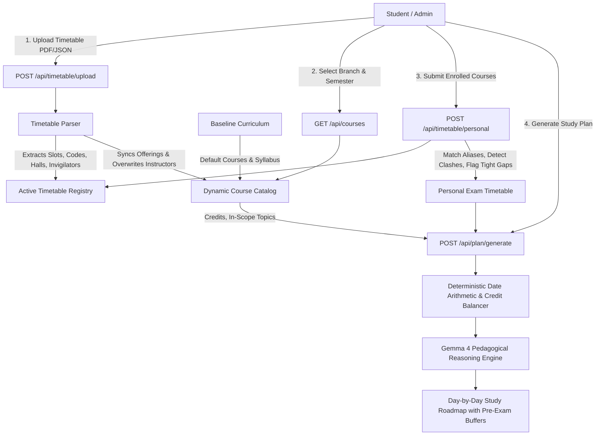

# System Architecture: Personalized Campus Exam Preparation Agent

## 1. High-Level Architecture Overview

---

## 2. Component Breakdown

### A. Dynamic Timetable Ingestion (`parsers/timetable_parser.py`)
- **Handles Jumbled PDF Layouts**: Robust regex & table extraction identifying slot headers:
  `Slot No | Date | Start to End | Total Students`
- **Cross-Listed Aliases**: Automatically detects and groups slash-separated course codes (e.g., `MAL403/IC105`, `CSL201/MAL503`, `CSL202/MAL504`).
- **Split Hall Aggregation**: Reconstructs courses spanning multiple lecture halls and invigilators.

### B. Dynamic Course Reconciliation (`parsers/curriculum_parser.py`)
- **Pristine Baseline**: `data/courses.json` and `data/curriculum.json` store official BTech Course of Study curriculum.
- **Runtime Overwrite**: When a master timetable is uploaded:
  - Instructors are updated directly from the live exam schedule.
  - Courses running this session are marked as `is_offered_this_sem = True`.
  - Inactive courses are preserved but flagged.
  - Newly introduced courses in the timetable are dynamically registered.

### C. Personal Exam Scheduling & Hazard Detection
- Matches enrolled courses against all aliases.
- **Clash Detection**: Detects if multiple exams occur in the same slot or overlapping hours.
- **Tight Gap Alerts**: Automatically computes intervals between successive exams and warns when preparation time is under 24 hours (e.g. CSL202 on Sept 24 and LAL100 on Sept 25 morning).

### D. Study Plan Generator (`planner.py`)
- **Credit Weighting**: Allocates study hours proportionally based on course credits (e.g. 4-credit heavy theory vs 2-credit communications).
- **Pre-Exam Buffer**: Automatically reserves the 24-hour window before each exam strictly for targeted revision and past paper practice.
- **Gemma 4 Reasoning**: Enriches the schedule with strategic study recommendations.
